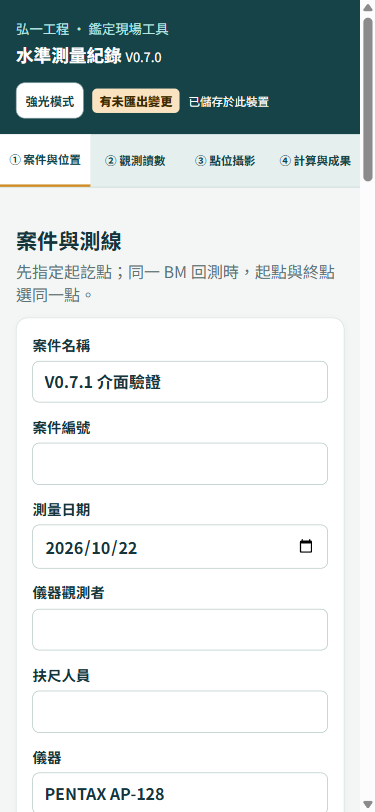
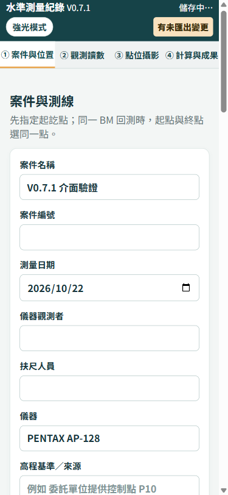
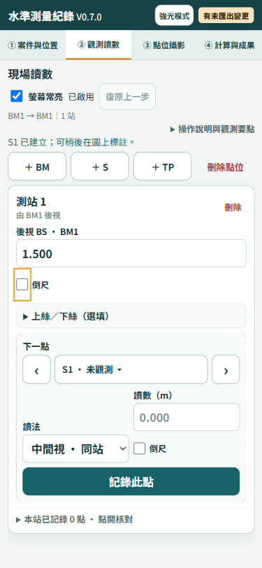
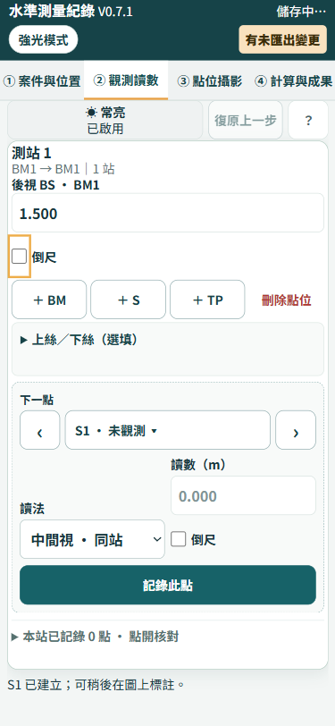
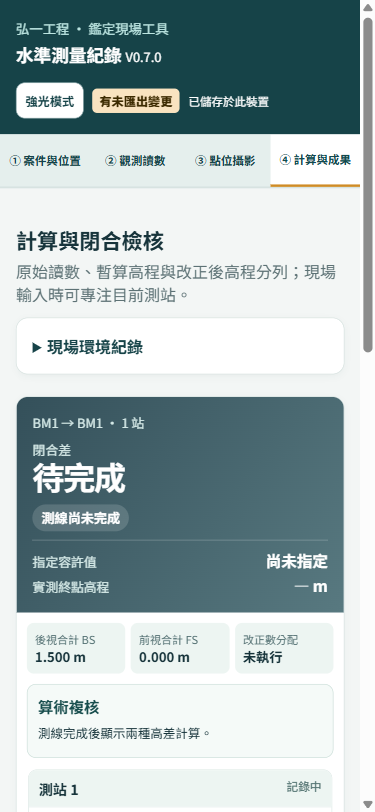
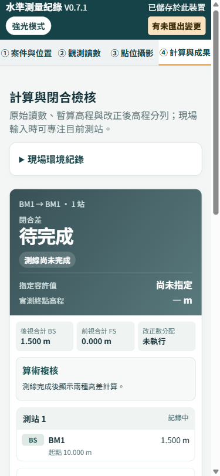
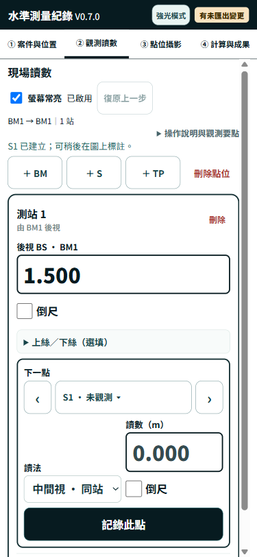
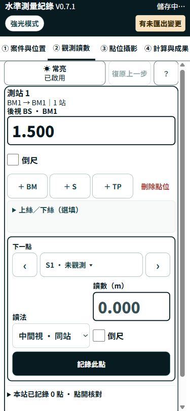

# V0.7.1 介面細節與輸入防呆

日期：2026-10-22。基準 main `bde44a2de9c5ee8af612c2c6dd76a73c4f13a1f9`；工作分支 `codex/v0.7.1-ui-polish`。僅推送分支及建立 PR，尚未合併／部署。PR 連結與交付 HEAD 見派工回報。

## 本版內容

| 任務 | 改動及界線 |
| --- | --- |
| M1 | 新增純函式 `readingFormatIssue`；BS／IS／FS／下一點／上下絲及兩樁法讀數即時格式警示。錯誤格式不寫模型、不開更正對話框，保留欄位原文。逗號小數維持支援。舊檔錯誤讀數在計算前回報點號，不改寫原值。`readingIssue` 及既有公式不變。輸入錯誤的下一點讀數仍清除舊復原資格，延續 V0.7.0 規則。 |
| M2 | 更正預覽列出測站、點號、讀數角色、前後值、m 單位及倒尺；焦點到原因選單，Esc 取消並還原。同字串值不開更正對話框。 |
| M3 | 12 個指定設計變數及 5 個補充色票；衍生色使用 RGB 通道運算，避免轉檔器不支援的現代色彩函式。強光模式僅覆寫變數。6 段原有列印區塊文字不變（比較時統一換行）。 |
| M4 | 手機標題、匯出膠囊與強光按鈕收斂；常亮／復原／說明同列。測線摘要移入測站標題下方，點位操作移到 BS 下方，刪站保留於「點開核對」。舊有 162 個靜態 id 全部保留。 |
| M5 | 所有 decimal 欄位有 Next，下一點為 Done，Enter 記錄；保留 IME 組字與連按防護。加入 reduced-motion，訊息使用 status／polite，錯誤切為 assertive。版本同步 0.7.1。 |

`schema:1`、IndexedDB 版本及 `level-survey-case.v1` 不變；`store.js`、`integrity.js` 未修改。`sw.js` 只改 CACHE 版本常數（依完成定義），快取策略與 APP_FILES 不變；無新增執行期檔案、CDN 或套件。CSP `script-src 'self'` 不變。`calculate` 僅加上本派工明定的舊資料格式前置診斷，未改計算公式、中間視改正或 K。

## 驗證

- 開工工作樹乾淨，main／origin/main／HEAD 同為 `bde44a2`；`node --test` 基準 67／67。
- 完成 `node --test` **75／75**，新增 8 項測試，既有斷言保留。新增涵蓋多小數點、逗號、abc、尾點、空白／空格、BS／IS／FS／上下絲、舊資料格式錯誤、更正預覽／焦點、錯誤草稿的復原界線與 V0.7.0 相容性。
- 14 個歷史版本建立函式案例（V0.1.0～V0.7.0）可讀回，保留原始讀數與空白觀測時間。V0.7.0 案例重建來源為 `bde44a2` 的 `blankProject()`，並非取得現場歷史匯出檔。
- `node --check app.js`、`node --check calc.js`、`node --check sw.js`、`git diff --check` 全通過；交付時再對提交後 HEAD 重跑。
- `checks/v071-browser.js`：375×812 格式錯誤 blur 後持久值仍為 1.500、audit=0；更正前後值／焦點／Esc、同值、常亮開關、說明入口、錯誤 Enter 阻擋、有效 Enter 記錄、上下絲、21 個受測 decimal 欄位的 hint、reduced-motion、PDF 下載均完成。pageerror=0；不等同所有 console／網路診斷皆為零。
- `checks/v071-offline-browser.js`：關閉網路後以新分頁開啟帶 `?release=0.7.1` 的網址，載入 V0.7.1 且 BS=1.500、IS=0.500 保留。
- 訊息 live region 設為 polite／assertive；本次未實測手機螢幕閱讀器播報。

### M3 色票與色差

U1 依派工預設採水準測量現行主色。下表以 HEX 表示最終數值；CSS 以 17 組 RGB 通道作為色票來源，衍生值沿用變數計算。強光另有 3 個 HEX 常數 `#071B20`、`#112D31`、`#7B1600`。

| 變數 | 最終數值 |
| --- | --- |
| `--ink` | `#17343B` |
| `--muted` | `#5D7275` |
| `--accent` | `#176268` |
| `--accent-strong` | `#114A50` |
| `--paper` | `#FFFFFF` |
| `--line` | `#D4E0DD` |
| `--bg` | `#F3F6F5` |
| `--warn` | `#EEAD49` |
| `--danger` | `#AD3932` |
| `--bm` | `#214E64` |
| `--s` | `#C25430` |
| `--tp` | `#8658AE` |
| `--brand` | `#164348` |
| `--black` | `#000000` |
| `--hero-end` | `#247A76` |
| `--check-ok` | `#176544` |
| `--ochre` | `#8A6A16` |

色碼依派工的 HEX 正則統計：全檔不同值 **136 → 12**；排除列印區塊 **133 → 3**，達 ≤20 指標。另明列 17 組 RGB 色票，沒有把其餘 100 多色另寫死為 RGB 常數。

同一 DOM 配對的前景、背景、四邊框與 placeholder 色，以 sRGB／D65／CIELAB ΔE76 比較；透明色先合成於白底。案件／觀測／成果最高 **9.02**，強光及強光按鈕 hover 最高 **4.45**，受測配對無 ≥10。這是受測畫面與狀態的結果，不宣稱窮舉所有 CSS 狀態。詳見 [色差](assets/v0.7.1-colors.json)及[來源檢查](assets/v0.7.1-source.json)。

傾斜測量 repo 現行主色不同；本任務未修改該 repo，不宣稱兩工具已同步完成。依 U1 預設，由傾斜測量 V0.4.1 跟進本表；其他基準留待委託人核對。

### M4 量測

| 項目（375×812 Chromium） | 改前 | 改後一般 | 改後強光 | 指標 |
| --- | ---: | ---: | ---: | --- |
| topbar 高度 px | 43.43 | 67.99 | 71.98 | ≤72 |
| tabs 高度 px | 42.60 | 44.61 | 48.61 | 觸控目標一般≥44／強光≥48 |
| 第一讀數欄距頁首 px | 342.26 | 216.18 | 229.40 | ≤230 |
| 橫向捲動 | 無 | 無 | 無 | 無 |

一般／強光控制元件 CSS 最小高度分別 44／48 px，幾何讀值約 43.998／47.996 px；瀏覽器小數取整後為 44／48。左右點位鍵及說明鍵的配置寬度額外加 1 px。讀數輸入一般 16 px、強光 30 px；本次修改的控制文字不低於 14 px。膠囊視覺高度 32 px、按鈕實際操作區 44／48 px。

`grep -c enterkeyhint app.js` 等價行數統計 **0 → 2**；靜態 decimal 欄位亦加屬性，動態欄位共用模板。原始量測：[瀏覽器結果](assets/v0.7.1-browser.json)、[離線結果](assets/v0.7.1-offline.json)。

### 試跑失敗與修復

- 前期瀏覽器試跑曾因 `beforeunload` 中斷及只等待「已載入」而逾時；改用獨立測試瀏覽器及等待實際可用狀態後完成，未將中斷計為通過。
- 隱藏常亮 checkbox 的點擊定位曾逾時；改成覆蓋整個切換鈕的原生透明輸入區，重跑開／關驗證通過。
- 最初使用 `color-mix()` 時，PDF 轉檔失敗：`Attempting to parse an unsupported color function "color"`。已改為 RGB 通道變數及 `calc()`，沒有更換第三方套件或降低 PDF 畫質。
- 色差比對曾因新增可見元素造成陣列錯配；改以同一 DOM 元素索引配對後重新計算。此為驗證程式修正，未忽略實際配對中的超標值。
- 新增的觸控寬度檢查遇到 44 px 格線被瀏覽器量成 43.998 px；左右點位鍵及「？」欄增加 1 px，保留原檢查，不以放寬斷言處理。

### PDF 煙霧測試與待決

RGB 修正後，本案可下載 2 頁 A4 PDF，Poppler 逐頁渲染均有內容，設備參考照及頁尾存在。仍觀察到「四、儀器檢校及設備照片」標題在頁界裁切；將同一報告 DOM 套回 V0.7.0 CSS 亦重現。報告產生器與 `pdf-pages.js` 未改，本版未擴大修正分頁。這不是 PDF 排版完整通過，也未執行實體列印；PDF 僅為測試證據，非正式報告附件。圖：[本版首頁](assets/v0.7.1-pdf-1.png)、[本版末頁](assets/v0.7.1-pdf-2.png)、[同報告套舊 CSS](assets/v0.7.1-baseline-pdf-1.png)。

## 改前／改後截圖

| 分頁／模式 | 改前 | 改後 |
| --- | --- | --- |
| 案件 |  |  |
| 觀測 |  |  |
| 成果 |  |  |
| 強光 |  |  |

以下 15 張 SHA-256 彼此不同，未重複沿用相同圖檔；同一改前／改後觀測畫面同時支援 M3、M4 核對。

| 畫面 | SHA-256 |
| --- | --- |
| [改前：案件](assets/v0.7.1-before-route.png) | `6F05626D12EAC2F2B367B4DFCF382EA7157BC444ADE8D0C991482937FB8E0DFE` |
| [改後：案件](assets/v0.7.1-after-route.png) | `9F5B72C6B32C48A43CD2A83BBEDE807274F6629875106C968CA320E110D6D163` |
| [改前：觀測](assets/v0.7.1-before-measure.png) | `C9333B5AED297309F81C8BDE8A488C397122989191058233CDE7B67183446DD9` |
| [改後：觀測](assets/v0.7.1-after-measure.png) | `6E648FB1F4D3BEA5CCDD1651370370B15A5D2D565B0DF49B184250AA63EA4C7C` |
| [改前：成果](assets/v0.7.1-before-result.png) | `B117DB4393CF43620872B97E72FAB94344BDAB48398D185045571EBC3633E796` |
| [改後：成果](assets/v0.7.1-after-result.png) | `ACBB0A5B63359AAA8CD5DED8B35D2F61CA5595A761D6352AF93F44158A26F304` |
| [改前：強光](assets/v0.7.1-before-sunlight.png) | `1C0A39421D4482026485FD1D3306D1E4E6FA70F8105279BB3A590C1E060EB16F` |
| [改後：強光](assets/v0.7.1-after-sunlight.png) | `3988E26D2C74ECD993B0090217BD2AD89C0F16BD497C51FB5C65746A5B7A5A46` |
| [格式警示](assets/v0.7.1-format-warning.png) | `B32D601E5BEAB21072395AE30417161112F9F7B9010F8345AD83A2F599F02776` |
| [更正對話框](assets/v0.7.1-correction.png) | `AE59EEEDE6E040B605065779E37183F674B6B3EE0D39E94A799FD0AD7430CB00` |
| [離線重新開啟](assets/v0.7.1-offline.png) | `2DE87C3B90832E5DDEB05DA98B0294ECE00AB8ED2747AC23780FE41BF9733878` |
| [PDF 預覽](assets/v0.7.1-report-preview.png) | `339FDC7F4C20C5DEE183C695BF5C32658DDA95DF7F8589A439D6E50F51F6A380` |
| [本版 PDF 第 1 頁（測試用）](assets/v0.7.1-pdf-1.png) | `47BD20152A693FAD435E8C30E858B55F23BE2CBB9FE4D2F9D13D219030AB1354` |
| [本版 PDF 第 2 頁（測試用）](assets/v0.7.1-pdf-2.png) | `7F7B14E2196C0AA875B8BE107C905CE872C532A59F7F12EDFA13B0347C87AAB1` |
| [同一報告套回舊版 CSS 第 1 頁](assets/v0.7.1-baseline-pdf-1.png) | `D1631553057C83D898B8C96146C31C16FCDD23DFED96D2E7A9D95163B94E33DF` |

## 待核對與停止點

- 尚未合併 main、未部署；本分支即為待審內容，`published=false`。
- U1 跨工具色票：A 依派工預設由傾斜 V0.4.1 跟進水準本表；B 另定傾斜現行色為共同基準，再開後續色差核對。本版保留 A 的水準端結果，不擅自修改另一 repo。
- PDF：後續可獨立修正標題不可拆分／分頁切點；或維持本 PR 範圍，將此排版問題另案處理。未自行修改派工禁止變動的列印樣式。
- 中間視改正方式、視距 K 維持本版不處理。
- 尚未驗證實體 iPhone／Android 的鍵盤、長時間常亮、省電及大量照片；Chromium 尺寸模擬不等於手機實機驗收。
- 交付派工回報後停止，核對期間不改分支。

## 補修紀錄

- A（2026-10-22）：格式檢核先 trim，保留舊讀數計算相容性；僅差前後空白不開更正對話框，實際值變動仍保留更正原因流程。新增 4 項測試，79／79 通過。
